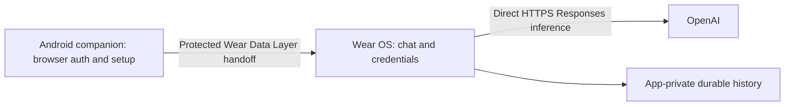

# WristPrompt

Your key. Your model. Your watch.

  

A native, local-first OpenAI client for Wear OS with an Android setup companion.
Continue with ChatGPT or choose an explicit API-key billing path. After setup,
inference runs directly on the watch, with no WristPrompt account or backend.

**v0.1.0 is an early source/developer release: READY WITH NON-BLOCKING DEBT.**
Build a matched phone/watch pair locally. No production-signed installable binaries
are distributed with this release. WristPrompt is not affiliated with OpenAI.

## Why WristPrompt

- Read and continue conversations on your watch with durable local history.
- Keep control of your account, model and billing path, with no silent fallback.
- Review text, presets and multiple photos before explicitly sending.
- Stop the actual HTTP request and retain only completed exchanges for replay.

Local-first does not mean offline AI: prompts, attachments and required conversation
context go to OpenAI. Google Play services may relay phone/watch Data Layer traffic.

## Features

- Continue with ChatGPT; separate OpenAI API-key/BYOK mode and account-specific models.
- Watch-direct Responses streaming, real Stop and explicit Latest without forced scrolling.
- Saved chats: reopen, continue, rename and delete; restart restores idle, never auto-sends.
- Phone-managed prompt presets synchronized to the watch for insertion and editing.
- Android Photo Picker library, protected app-private files and paired photo synchronization.
- Text plus one or multiple images on supported models/routes; clear unsupported errors.
- Provider-native Thinking controls with exact supported values. The ChatGPT-plan route
  exposes **Default only** because authoritative per-model native effort lists are unavailable.
- API-key image-generation implementation and fullscreen zoom/pan viewer. Automated/emulator
  acceptance passed; owner live API-key verification is blocked by unavailable credentials.
- Native Markdown, horizontally scrollable code, rotary navigation and round-screen UI.
- Account, Settings and sanitized Diagnostics; no analytics or developer-operated cloud sync.

## Architecture



The phone handles setup and preset/photo management; it is not the normal inference
proxy. See [architecture](docs/ARCHITECTURE.md) for ownership and trust boundaries.

## Billing / authentication

**ChatGPT plan** uses eligible account access through Continue with ChatGPT.
**API key** uses your OpenAI API key and separately billed API usage. A ChatGPT
subscription does not include API credits. Model discovery does not guarantee
eligibility, quota or inference success. Errors never switch models or billing paths.

## Tested

Owner physical core acceptance passed on **Galaxy Watch 7 SM-L310, Wear OS / API 36**
and a paired Android phone: startup/auth, history, presets, photo sync, supported
multimodal inference, composer/IME, plan Thinking and general large-font/rotary UI.
Unit, protocol, storage and synthetic emulator coverage is recorded separately in
[final acceptance](docs/D7_G_ACCEPTANCE.md). This is not universal Wear compatibility
or a live paid API-key success claim. TalkBack and battery/runtime profiling remain unverified.

## Known limitations

- [#1](https://github.com/grassified/WristPrompt/issues/1): structured Wear table records
  are absent on the tested physical path; content has a readable list fallback.
- [#11](https://github.com/grassified/WristPrompt/issues/11): live API-key image generation
  owner verification is blocked because no owner API key is available. ChatGPT-plan
  image generation is unsupported by design; optional generation does not gate core readiness.
- ChatGPT-plan Thinking is Default-only under the current capability contract.
- Sent input-image thumbnails are not shown in the completed chat transcript.
- No cloud chat sync. Unsent drafts and streaming tokens are not durable across process death.
- Saved continuation requires compatible original account/billing/model ownership.
  Screen-off/background continuation is best effort.

## Build from source

Use full JDK 17, SDK Platform `android-37.0`, Build Tools `36.0.0` and the included
Gradle wrapper. Minimum SDK: Wear 30, phone 26; compile / target SDK: 37 / 36.
Both apps use `io.github.grassified.wristprompt`, version `0.1.0` / code `1`.

```sh
export JAVA_HOME="/path/to/jdk17"
export ANDROID_HOME="$HOME/Android/Sdk"
./gradlew :wear:assembleDebug :mobile:assembleDebug
```

Build both apps with the same local signing identity. Preserve existing authenticated
installations; never replace owner keys or uninstall to bypass signing mismatches.
See [development setup](DEVELOPMENT.md) and [testing](docs/TESTING.md).

## Project documentation

- [Architecture](docs/ARCHITECTURE.md), [development](DEVELOPMENT.md), [testing](docs/TESTING.md)
- [Roadmap](ROADMAP.md), [specification](PROJECT_SPEC.md), [decisions](DECISIONS.md)
- [Changelog](CHANGELOG.md), [contributing](CONTRIBUTING.md), [developer handoff](docs/CODEX_HANDOFF.md)
- [Security](SECURITY.md), [privacy](PRIVACY.md), [historical evidence](docs/history/README.md)

## License

WristPrompt is **GPL-3.0-only**, with the [narrow project linking exception](LICENSE_EXCEPTION.md)
for four exact Google Play services artifact versions. The canonical [LICENSE](LICENSE)
remains GPLv3; this project-specific exception has no SPDX-listed identifier.
Commercial use, modification and redistribution remain subject to GPL obligations.
Third-party components retain their licenses; see [notices](THIRD_PARTY_NOTICES.md).
